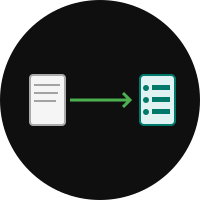

<p align="center" class="intro">
  
</p>

<p align="center" class="intro">
  <a href="https://github.com/fsegurai/manifest-generator">
      
  </a>
  <a href="https://github.com/fsegurai/manifest-generator/releases/latest">
      
  </a>
  <br>
  
  
  <a href="https://opensource.org/licenses/MIT">
    
  </a>
  <br>
  
  
</p>

# @fsegurai/manifest-generator

A CLI and library that scans Markdown/MDX documentation and generates hierarchical navigation manifests and search
indexes. Built with TypeScript, powered by Bun.

## What the package does

Given a directory of Markdown or MDX files with YAML frontmatter, `@fsegurai/manifest-generator` produces two artifacts:

- **`manifest.json`** — hierarchical navigation tree with sorting, frontmatter metadata, draft/hidden filtering, and
  folder inheritance
- **`search-index.json`** — flat search entries with keywords and descriptions

Supports 18 frontmatter keys, recursive project discovery, file watching, and frontmatter validation.

## Run locally (contributors)

### Requirements

- Node.js 22+, Bun 1.3+

### Setup

```bash
bun install
```

### Development workflow

```bash
# run all tests
bun test

# run tests with coverage
bun test --coverage

# run single-package tests
bun run --filter '@fsegurai/manifest-generator' pkg:test

# lint everything
bun run lint

# build package + demo
bun run build

# build only the library
bun run --filter '@fsegurai/manifest-generator' pkg:build
```

### Run the CLI locally

```bash
bun ./packages/manifest-generator/src/cli.ts --help
bun ./packages/manifest-generator/src/cli.ts --discover --docs-root ./docs
```

### Regenerate versioned docs (maintainers)

```bash
bun ./packages/manifest-generator/src/cli.ts \
  --docs-root ./docs/1.0.0-beta.2 \
  --output ./docs/1.0.0-beta.2
```

## CLI reference

```text
--discover        Auto-detect documentation projects in --docs-root
--validate        Validate frontmatter across all discovered projects
--recursive       Discover projects in nested directories
--watch           Watch for file changes and regenerate
--init            Scaffold a docs structure + config file (interactive on a TTY)
--all             Process all discovered projects
--project <name>  Target a specific project by name
--route <path>    Target a single documentation route
--docs-root <dir> Root directory for documentation discovery
--output <dir>    Output directory for generated manifests
--docs-subfolder  Custom subfolder name inside project dirs (default: docs)
--config <path>   Load an exact config file, skipping auto-detection
--json            Machine-readable JSON output (--discover / --validate)
--dry-run         Run generation without writing files to disk
--quiet, -q       Suppress banner/progress output (errors still show)
```

## Programmatic API

```ts
import {
    generateManifest,
    generateDocsManifests,
    discoverProjects,
    validateDocs,
    watchDocs,
    type NavigationItem,
} from '@fsegurai/manifest-generator'

// In-memory manifest generation
const result = await generateManifest('./docs')
console.log(result.navigation)
console.log(result.searchIndex)

// Discover projects then generate
const projects = await discoverProjects('./docs', {recursive: true})
await generateDocsManifests(projects, {outputDir: './dist'})

// Validate frontmatter
const {errors, warnings} = await validateDocs('./docs')

// Watch for changes
const watcher = await watchDocs('./docs', {
    outputDir: './dist',
    onGenerate: (result) => console.log('Regenerated:', result.project),
})
watcher.close()
```

## Use as an external user

```bash
npx @fsegurai/manifest-generator --help
npx @fsegurai/manifest-generator --route ./docs
npx @fsegurai/manifest-generator --discover --docs-root ./documentation
```

For full documentation, start with the versioned docs:

- `docs/1.0.0-beta.2/content/README.md`

## Frontmatter fields

The package reads YAML frontmatter from `.md` and `.mdx` files. Supported keys:

| Key                                    | Type           | Description                              |
|----------------------------------------|----------------|------------------------------------------|
| `label`                                | string         | Display name in navigation               |
| `description`                          | string         | Short description (used in search index) |
| `tags`                                 | string[]       | Content tags                             |
| `keywords`                             | string[]       | Search keywords                          |
| `order`                                | number         | Sort position in navigation              |
| `isTitle`                              | boolean        | Use as section title                     |
| `isParent`                             | boolean        | Mark as parent node                      |
| `icon` / `iconType`                    | string         | Icon reference                           |
| `badge` / `badgeColor`                 | string         | Badge text and color                     |
| `breadcrumbTitle`                      | string         | Override breadcrumb text                 |
| `layout`                               | string         | Layout template                          |
| `redirect` / `externalUrl`             | string         | URL redirects                            |
| `deprecated` / `deprecatedAlternative` | boolean/string | Deprecation status                       |
| `publishedAt` / `updatedAt`            | date           | Publication metadata                     |
| `draft`                                | boolean        | Hide from production                     |
| `hidden`                               | boolean        | Exclude from navigation                  |

## License

Licensed under [MIT](https://opensource.org/licenses/MIT).
