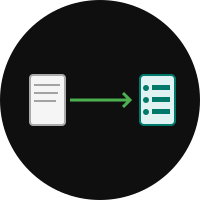

<p align="center" class="intro">
  
</p>

<p align="center" class="intro">
  <a href="https://github.com/fsegurai/manifest-generator">
      
  </a>
  <a href="https://github.com/fsegurai/manifest-generator/releases/latest">
      
  </a>
  <br>
  
  
  <a href="https://opensource.org/licenses/MIT">
    
  </a>
  <br>
  
  
</p>

**A library and CLI for generating navigation manifests and search indexes from Markdown/MDX documentation.**

`@fsegurai/manifest-generator` is a CLI and library that scans Markdown/MDX documentation and generates hierarchical navigation manifests and search
indexes. Built with TypeScript, powered by Bun.

### 📋 Table of Contents

- [🚀 Features](#-features)
- [📦 Installation](#-installation)
- [🖥️ CLI Usage](#️-cli-usage)
    - [Global Installation](#global-installation)
    - [Using npx (Recommended)](#using-npx-recommended)
    - [CLI Commands](#cli-commands)
    - [Production Examples](#production-examples)
- [📚 API Usage](#-api-usage)
    - [ES Modules](#es-modules)
    - [CommonJS](#commonjs)
    - [API Reference](#api-reference)
- [📁 Project Structure Detection](#-project-structure-detection)
- [📄 Output Files](#-output-files)
- [⚙️ Configuration](#️-configuration)
- [🔧 Integration Examples](#-integration-examples)
- [📝 Frontmatter Support](#-frontmatter-support)
- [🤝 Contributing](#-contributing)
- [📄 License](#-license)

---

## 🚀 Features

- **Automatic Discovery**: Intelligently finds documentation projects in various folder structures
- **Flexible Input**: Supports both direct markdown files and docs subfolders
- **CLI & API**: Use via command line or programmatically in your code
- **Frontmatter Parsing**: Extracts metadata from YAML frontmatter (21 recognized keys)
- **Search Index Generation**: Creates searchable indexes with excerpts, headings, and breadcrumbs, plus opt-in
  heading anchors (`sections`) for deep links
- **Opt-in page data**: `prev`/`next` links, unknown frontmatter in `meta`, and `wordCount`/`readingTime`
- **Config File Support**: `manifest-generator.config.{json,js,ts}` with CLI-flag override priority
- **TypeScript Support**: Full TypeScript definitions included
- **Cross-Platform**: Works on Windows, macOS, and Linux
- **Multiple Output Formats**: Generates both navigation manifests and search indexes

## 📦 Installation

### Global Installation

```bash
npm install -g @fsegurai/manifest-generator
```

### Project Dependency

```bash
# As a dev dependency
npm install --save-dev @fsegurai/manifest-generator

# As a regular dependency
npm install @fsegurai/manifest-generator
```

## 🖥️ CLI Usage

### Using npx (Recommended)

No installation required—run directly:

```bash
# Process all projects in current directory
npx @fsegurai/manifest-generator --all

# Process specific project
npx @fsegurai/manifest-generator --project my-docs

# Get help
npx @fsegurai/manifest-generator --help
```

### Global Installation

If installed globally, use the `manifest-generator` command:

```bash
manifest-generator --all
manifest-generator --project my-docs
```

### CLI Commands

#### Basic Usage

```bash
# Process all projects automatically
npx @fsegurai/manifest-generator --all

# Process a specific project by name
npx @fsegurai/manifest-generator --project sample-project

# Process a specific documentation path
npx @fsegurai/manifest-generator --route ./docs

# Discover projects without processing
npx @fsegurai/manifest-generator --discover
```

#### Advanced Options

```bash
# Specify custom docs root directory
npx @fsegurai/manifest-generator --all --docs-root ./my-projects

# Custom output directory
npx @fsegurai/manifest-generator --route ./docs --output ./dist

# Custom docs subfolder name (default: 'docs')
npx @fsegurai/manifest-generator --all --docs-subfolder documentation

# Process positional path argument
npx @fsegurai/manifest-generator ./path/to/documentation

# Recursively discover nested projects
npx @fsegurai/manifest-generator --discover --recursive

# Watch for file changes and regenerate
npx @fsegurai/manifest-generator --watch --route ./docs --output ./public

# Validate frontmatter without writing files
npx @fsegurai/manifest-generator --validate --docs-root ./docs

# Scaffold a new documentation structure + config file
npx @fsegurai/manifest-generator --init

# Load an exact config file instead of auto-detecting one
npx @fsegurai/manifest-generator --config ./config/manifest-generator.config.json

# Preview what would be written, without touching disk
npx @fsegurai/manifest-generator --all --dry-run

# Machine-readable JSON output (works with --discover / --validate)
npx @fsegurai/manifest-generator --discover --json

# Suppress banner/progress output (errors still print)
npx @fsegurai/manifest-generator --all --quiet

# Write prev/next page links on each page item (opt-in)
npx @fsegurai/manifest-generator --route ./docs --prev-next

# Heading anchors in the search index, custom frontmatter in `meta`, and reading time (all opt-in)
npx @fsegurai/manifest-generator --route ./docs --heading-anchors --extra-frontmatter --reading-time

# Do not report these frontmatter keys as unknown during --validate
npx @fsegurai/manifest-generator --validate --docs-root ./notes --ignore-keys title,created,updated
```

> `--validate`, `--discover`, `--watch`, and `--init` are mutually exclusive — pass at most one per invocation.

#### Help and Information

```bash
# Show help
npx @fsegurai/manifest-generator --help

# Show version
npx @fsegurai/manifest-generator --version
```

### Production Examples

#### CI/CD Pipeline (GitHub Actions)

```yaml
-   name: Generate Documentation Manifests
    run: npx @fsegurai/manifest-generator --all --docs-root ./projects
```

#### Monorepo Processing

```bash
# Process all packages in a monorepo
npx @fsegurai/manifest-generator --all --docs-root ./packages

# Process specific package
npx @fsegurai/manifest-generator --project my-package --docs-root ./packages
```

#### Build Pipeline Integration

```bash
# Generate manifests for built documentation
npx @fsegurai/manifest-generator --route ./dist/docs --output ./public
```

#### Package.json Scripts

```json
{
    "scripts": {
        "build:docs": "manifest-generator --all",
        "docs:manifest": "manifest-generator --route ./documentation",
        "docs:discover": "manifest-generator --discover"
    }
}
```

## 📚 API Usage

### ES Modules

```javascript
import {
    generateManifest,
    generateDocsManifests,
    generateManifestsWithDiscovery,
    discoverProjects
} from '@fsegurai/manifest-generator';

// Generate manifest for a single project
const result = generateManifest('./docs');
console.log('Generated:', result.manifest);
console.log('Search Index:', result.searchIndex);

// Process all projects with auto-discovery
const results = generateManifestsWithDiscovery('./projects', {
    autoDetect: true,
    docsSubfolder: 'docs'
});

// Discover projects without processing
const projects = discoverProjects('./projects');
console.log('Found projects:', projects);
```

### CommonJS

```javascript
const {
    generateManifest,
    generateManifestsWithDiscovery
} = require('@fsegurai/manifest-generator');

// Process specific project
generateManifestsWithDiscovery('./projects', {
    project: 'my-app',
    outputDir: './dist'
});
```

### API Reference

Every function/type below is re-exported from `src/index.ts`'s final `export { ... }` / `export type { ... }` blocks.

#### Core Functions

##### `generateManifest(projectPath: string, exclude?: string[], options?: ManifestOptions): ManifestResult`

Generates a manifest for a single documentation project. `exclude` accepts the same glob patterns used elsewhere.
`options.prevNext` adds `prev`/`next` links (see [Previous / next links](#previous--next-links)) and
`options.frontmatterAliases` maps foreign frontmatter keys (see [Frontmatter aliases](#frontmatter-aliases)).
`options.headingAnchors`, `options.extraFrontmatter` and `options.readingTime` add the opt-in fields described in
[Heading anchors](#heading-anchors), [Extra frontmatter](#extra-frontmatter) and [Reading time](#reading-time).

```javascript
const result = generateManifest('./my-docs');
// Returns: { manifest: NavigationItem[], searchIndex: SearchEntry[] }
```

##### `generateDocsManifests(docsRoot: string, optionsOrWalker?): ProcessingResult[]`

Discovers projects under a root and writes `manifest.json` + `search-index.json` for each one. Accepts either a
`walkerFn` directly, or an options object (`docsSubfolder`, `recursive`, `exclude`, `projects`, `dryRun`, `prevNext`,
`frontmatterAliases`, `headingAnchors`, `extraFrontmatter`, `readingTime`, `walkerFn`).

```javascript
generateDocsManifests('./projects', { recursive: true });
```

##### `generateManifestsWithDiscovery(rootDir: string, options?: ManifestGenerationOptions): ProcessingResult[]`

Advanced function with flexible options and auto-discovery. Checked in this order: `route` → `project` → `autoDetect`.

```javascript
const results = generateManifestsWithDiscovery('./projects', {
    project: 'specific-project',     // Process specific project
    route: './custom/path',          // Process specific path
    outputDir: './output',           // Custom output directory
    docsSubfolder: 'documentation',  // Custom docs folder name
    autoDetect: true,                // Auto-discover projects
    recursive: false,                // Recurse into nested project dirs
    exclude: ['drafts/**'],          // Glob patterns to skip
    projects: {},                    // Per-project docsSubfolder/outputDir overrides
    dryRun: false,                   // Log instead of writing files
    prevNext: false,                 // Write prev/next page links (opt-in)
    headingAnchors: false,           // Write h2/h3 sections with ids on search entries (opt-in)
    extraFrontmatter: false,         // Copy unknown frontmatter keys into `meta` (opt-in)
    readingTime: false,              // Write wordCount/readingTime on page items (opt-in)
    frontmatterAliases: {}           // e.g. { title: 'label' } — no default aliases
});
```

##### `discoverProjects(rootDir: string, options?: DiscoveryOptions): DiscoveredProject[]`

Discovers documentation projects without processing them.

```javascript
const projects = discoverProjects('./projects', {
    docsSubfolder: 'docs',   // Folder name to look for
    recursive: false,        // Discover nested project dirs
    exclude: []              // Glob patterns to skip
});
```

##### `validateDocs(rootDir: string, options?: ValidateOptions): ValidateResult[]`

Validates frontmatter across all `.md`/`.mdx` files under a directory (recursively), without writing output. Checks
date validity, conflicting flags, missing alternatives, unknown keys, and duplicate `redirect` targets.
`options.frontmatterAliases` validates aliased keys as their targets (and stops reporting the alias keys as unknown);
`options.ignoreKeys` lists keys never reported as unknown.

```javascript
const results = validateDocs('./docs');
const invalid = results.filter((r) => !r.valid);

// Notes written for another tool
validateDocs('./notes', { frontmatterAliases: { title: 'label' }, ignoreKeys: ['mood'] });
```

##### `watchDocs(rootDir: string, onChange: (changedFile: string) => void, interval?: number): { close: () => void }`

Polls a directory (default 1000ms) and invokes `onChange` with the changed file's path. Returns `{ close() }` to stop.

```javascript
const watcher = watchDocs('./docs', (changedFile) => console.log('Changed:', changedFile));
watcher.close();
```

##### `defineConfig(config: ConfigFile): ConfigFile`

Type-safe identity helper for `manifest-generator.config.ts` files.

#### Utility Functions

##### `formatTitle(name: string): string`

Converts filenames/folder names to readable titles (strips `.md`/`.mdx`, replaces `-` with spaces, title-cases).

```javascript
formatTitle('getting-started-guide.md'); // "Getting Started Guide"
```

##### `parseFrontmatter<T>(content: string): T`

Extracts and parses YAML frontmatter from Markdown/MDX content via `js-yaml` (`JSON_SCHEMA`). Returns `{}` if there's
no frontmatter block or it fails to parse.

```javascript
const frontmatter = parseFrontmatter(`---
label: My Document
tags: ["guide", "tutorial"]
---
# Content here`);
// Returns: { label: "My Document", tags: ["guide", "tutorial"] }
```

##### `sortItems(items: NavigationItem[]): NavigationItem[]`

Sorts items by `order` (ascending, default `999`) then alphabetically by `label`; recurses into `children`.

##### `cleanItem(item: NavigationItem): NavigationItem`

Strips `null`/`false`/`''`/`undefined` fields (recursing into `children`) before an item is written to
`manifest.json`. Not applied to `search-index.json` entries.

##### `extractHeadings(body: string): string[]`

Extracts `##`/`###` headings from a document body (lines inside fenced code blocks are skipped) and deduplicates them
via `dedupeHeadings()`.

##### `extractSections(body: string): PageSection[]`

Returns the `##`/`###` ATX headings of a body (outside fenced code) as `{ text, id, level }`, with the GitHub-style id
a slugger gives each one. Used by the `headingAnchors` option; see [Heading anchors](#heading-anchors).

##### `slugifyHeading(text: string): string`

The GitHub-style slug of a heading text (as `github-slugger`), without the uniqueness suffix.

##### `dedupeHeadings(headings: string[], threshold?: number): string[]`

Collapses near-identical headings using `diceSimilarity()` (default threshold `0.7`).

##### `diceSimilarity(a: string, b: string): number`

Sørensen–Dice coefficient (bigram-based similarity, 0–1) between two strings.

##### `makeExcerpt(body: string, maxLength?: number): string`

Strips Markdown syntax and truncates to roughly `maxLength` characters (default `150`), preferring a sentence or word
boundary.

##### `makeBreadcrumb(chain: BreadcrumbSegment[], self: BreadcrumbSegment): BreadcrumbSegment[]`

Appends `self` — the item's own `{ label, route }` segment — to `chain` (the already-resolved ancestor segments),
returning `[...chain, self]`. Every item (folder or leaf) ends up with a non-empty breadcrumb array whose last
segment is itself; a root-level page with no ancestors gets a single-segment array containing just itself.
`walkDocs()` builds and passes the ancestor chain internally — see
[migration notes](#-since-beta-breadcrumb-migration-notes) if you call this directly.

##### `walkDocs(dir: string, relative?: string, searchIndex?: SearchEntry[], exclude?: string[], chain?: BreadcrumbSegment[], options?: WalkOptions): NavigationItem[]`

The recursive directory walker that builds the navigation tree and populates `searchIndex` as a side effect. Exposed
for advanced/custom pipelines. It is the file-system form of the node-free `walkTree` from
[`@fsegurai/manifest-generator/core`](#browser-safe-core-entry).

##### `ALLOWED_FRONTMATTER_KEYS: ReadonlySet<string>`

A readonly `Set` of all 21 recognized frontmatter key names — see [Frontmatter Support](#-frontmatter-support). Useful
for external validation tooling.

#### Browser-safe core entry

`@fsegurai/manifest-generator/core` has no `node:*` imports, so it runs in browsers, workers, and other runtimes. It
exposes the pure helpers above plus `generateManifestFromFiles`, which builds the manifest and search index from
in-memory files and returns the same result as `generateManifest(dir)` for the same tree on disk.

```ts
import { cleanItem, generateManifestFromFiles } from '@fsegurai/manifest-generator/core';

const { manifest, searchIndex } = generateManifestFromFiles(
  [
    { path: 'README.md', content: '---\nlabel: Home\n---\n# Welcome' },
    { path: 'guides/theming.md', content: '---\nlabel: Theming\n---\n## Colors' },
  ],
  { exclude: ['drafts/**'], prevNext: true, frontmatterAliases: { title: 'label' } },
);
const manifestJson = JSON.stringify(manifest.map(cleanItem), null, 2); // what manifest.json contains
```

Also exported: `walkTree(reader, ...)` (the shared walker over a `DocsReader`), `createMemoryReader(files)`,
`applyPrevNext(items)`, and `applyFrontmatterAliases(frontmatter, aliases)`. In-memory directories are listed by name,
which matches Node's `readdir` order, so `search-index.json` entries come out in the same order as the Node CLI.

#### Types and JSON Schema entry

`@fsegurai/manifest-generator/schema` is a types-only entry (`NavigationItem`, `SearchEntry`, `BreadcrumbSegment`,
`PageLink`, `Frontmatter`, …) for consumers that only read the generated files:

```ts
import type { NavigationItem, SearchEntry } from '@fsegurai/manifest-generator/schema';
```

JSON Schemas (draft-07) for both files ship with the package:
`@fsegurai/manifest-generator/schema/manifest.schema.json` and
`@fsegurai/manifest-generator/schema/search-index.schema.json`. They reject unknown properties, so they also catch
format drift.

#### TypeScript Types

```ts
interface BreadcrumbSegment {
    label: string;
    route: string;
}

interface NavigationItem {
    label: string;
    route?: string;
    tags?: string[];
    isTitle?: boolean;
    isParent?: boolean;
    description?: string;
    icon?: string | null;
    iconType?: string | null;
    badge?: string | null;
    badgeColor?: string | null;
    order?: number;
    redirect?: string;
    externalUrl?: string;
    breadcrumbTitle?: string;
    breadcrumb?: BreadcrumbSegment[];
    layout?: string;
    deprecated?: boolean;
    deprecatedAlternative?: string;
    publishedAt?: string;
    updatedAt?: string;
    keywords?: string[];
    prev?: PageLink;   // only with the prevNext option
    next?: PageLink;   // only with the prevNext option
    meta?: Record<string, unknown>; // only with the extraFrontmatter option
    wordCount?: number;             // only with the readingTime option
    readingTime?: number;           // minutes; only with the readingTime option
    children?: NavigationItem[];
}

interface PageLink {
    label: string;
    route: string;
}

interface SearchEntry {
    label: string;
    description?: string;
    route: string;
    tags?: string[];
    headings?: string[];
    excerpt?: string;
    breadcrumb?: BreadcrumbSegment[];
    sections?: PageSection[]; // only with the headingAnchors option
    hidden?: boolean;         // true for a `hidden: true` page (searchable, not in the navigation)
}

interface PageSection {
    text: string;   // plain heading text
    id: string;     // GitHub-style slug, unique in the page
    level: 2 | 3;
}

interface ManifestResult {
    manifest: NavigationItem[];
    searchIndex: SearchEntry[];
}

interface DiscoveredProject {
    name: string;
    projectPath: string;
    docsPath: string;
    type: 'subfolder' | 'direct' | 'recursive';
}

interface ProcessingResult {
    name: string;
    processed: boolean;
    error?: string;
}

interface DiscoveryOptions {
    docsSubfolder?: string;
    recursive?: boolean;
    exclude?: string[];
}

interface ManifestGenerationOptions {
    project?: string | null;
    route?: string | null;
    outputDir?: string | null;
    docsSubfolder?: string;
    autoDetect?: boolean;
    recursive?: boolean;
    exclude?: string[];
    projects?: Record<string, ProjectConfig>;
    dryRun?: boolean;
    prevNext?: boolean;
    frontmatterAliases?: Record<string, string>;
    headingAnchors?: boolean;
    extraFrontmatter?: boolean;
    readingTime?: boolean;
}

interface ProjectConfig {
    docsSubfolder?: string;
    outputDir?: string;
}

interface ConfigFile {
    docsRoot?: string;
    docsSubfolder?: string;
    outputDir?: string;
    recursive?: boolean;
    exclude?: string[];
    projects?: Record<string, ProjectConfig>;
    prevNext?: boolean;
    frontmatterAliases?: Record<string, string>;
    ignoreKeys?: string[];
    headingAnchors?: boolean;
    extraFrontmatter?: boolean;
    readingTime?: boolean;
}

interface ValidateResult {
    file: string;
    valid: boolean;
    warnings: string[];
    errors: string[];
    frontmatter?: Frontmatter;
}
```

> `loadConfig`, `loadConfigFromFile`, `mergeConfig`, and `parseConfigFile` live in `src/config.ts` but are **not**
> re-exported from the package root — only `defineConfig` is public.

#### 🔄 Since Beta: Breadcrumb Migration Notes

`breadcrumb` data has changed shape twice in this pre-1.0 window; this note describes only the **current** (final)
shape rather than walking through both intermediate states.

- `breadcrumb` is now a **structured array of segments** (`BreadcrumbSegment[]`, `{ label, route }`), not a
  `" > "`-joined string.
- Every item — folder or leaf — **always** has a non-empty `breadcrumb` array, and that array now includes the item
  **itself** as its final segment, not just its ancestors. A root-level page with no ancestors gets a single-segment
  array containing just itself; there is no more `undefined`/omitted case.
- `NavigationItem` (in `manifest.json`) now also carries `breadcrumb`, alongside `SearchEntry` (in
  `search-index.json`), which had it already.
- A leaf file's own `breadcrumbTitle` frontmatter now overrides that file's own final breadcrumb segment's label — it
  is no longer inert for its own entry. A folder's `breadcrumbTitle` (via that folder's `README.md`/`index.md`) still
  only affects how that folder's segment appears in **descendants'** breadcrumbs.
- `makeBreadcrumb()`'s signature is now `makeBreadcrumb(chain: BreadcrumbSegment[], self: BreadcrumbSegment):
  BreadcrumbSegment[]`, returning `[...chain, self]`. If you call it directly instead of relying on `walkDocs()`,
  build the ancestor `chain` yourself and pass your own resolved `self` segment.
- Route-prefix rewriting (`outputDir` different from the source dir) now also rewrites every breadcrumb segment's
  `route`, so breadcrumb links stay correct in prefixed/multi-project output.

## 📁 Project Structure Detection

The generator automatically detects different documentation structures:

### Structure 1: Docs Subfolders

```
projects/
├── project-a/
│   ├── docs/           ← Documentation here
│   │   ├── README.md
│   │   ├── guide.md
│   │   └── api/
│   ├── manifest.json   ← Generated here
│   └── search-index.json
└── project-b/
    └── docs/
        └── *.md files
```

### Structure 2: Direct Markdown Files

```
projects/
├── project-a/
│   ├── README.md       ← Documentation here
│   ├── guide.md
│   ├── manifest.json   ← Generated here
│   └── search-index.json
└── project-b/
    └── *.md files
```

### Structure 3: Custom Documentation Folders

```
projects/
├── project-a/
│   ├── documentation/  ← Custom folder name
│   │   └── *.md files
│   ├── manifest.json
│   └── search-index.json
```

## 📄 Output Files

### manifest.json

Contains the hierarchical navigation structure (`label`/`route`, matching `NavigationItem`). Fields that are
`null`/`false`/`''`/`undefined` are stripped by `cleanItem()` — they are simply absent, never written as literal
`null`/`false`/`''`:

```json
[
    {
        "label": "Getting Started",
        "route": "getting-started",
        "tags": [
            "tutorial",
            "beginner"
        ]
    },
    {
        "label": "API Reference",
        "route": "api",
        "isParent": true,
        "children": [
            {
                "label": "Authentication",
                "route": "api/auth",
                "tags": [
                    "api",
                    "security"
                ]
            }
        ]
    }
]
```

### search-index.json

Contains flattened search data (`SearchEntry[]`), including derived `headings`, `excerpt`, and `breadcrumb`:

```json
[
    {
        "label": "Getting Started",
        "route": "getting-started",
        "tags": [
            "tutorial",
            "beginner"
        ],
        "headings": [
            "Installation",
            "Next steps"
        ],
        "excerpt": "This guide walks through installing and configuring the CLI for your project.",
        "breadcrumb": [
            {
                "label": "Guides",
                "route": "guides"
            },
            {
                "label": "Getting Started",
                "route": "guides/getting-started"
            }
        ]
    },
    {
        "label": "Authentication",
        "route": "api/auth",
        "tags": [
            "api",
            "security"
        ],
        "excerpt": "Authenticate requests using an API key or bearer token.",
        "breadcrumb": [
            {
                "label": "Api",
                "route": "api"
            },
            {
                "label": "Authentication",
                "route": "api/auth"
            }
        ]
    }
]
```

## ⚙️ Configuration

### Frontmatter Options

Control document processing with frontmatter — see [Frontmatter Support](#-frontmatter-support) for the full list:

```markdown
---
label: "Custom Title"           # Override generated title
tags: ["api", "reference"]     # Add searchable tags
draft: true                    # Exclude from manifest
hidden: true                   # Leave out of navigation (still routable and searchable)
---

# Your content here
```

### Config File

Create `manifest-generator.config.json`, `manifest-generator.config.js`, or `manifest-generator.config.ts` in your
project root, and it's auto-detected (in that lookup order); or point at an exact file with `--config <path>`.

```ts
// manifest-generator.config.ts
import { defineConfig } from '@fsegurai/manifest-generator';

export default defineConfig({
    docsRoot: './projects',        // Root directory to scan (overridable by --docs-root)
    docsSubfolder: 'docs',         // Subfolder name inside each project
    outputDir: './dist',           // Output directory for generated files
    recursive: true,               // Discover projects in nested directories
    exclude: ['**/drafts/**'],     // Glob patterns to skip (supports `*` and `**`)
    prevNext: true,                // Write prev/next page links (opt-in)
    headingAnchors: true,          // h2/h3 sections with ids on search entries (opt-in)
    extraFrontmatter: true,        // Unknown frontmatter keys in `meta` (opt-in)
    readingTime: true,             // wordCount/readingTime on page items (opt-in)
    frontmatterAliases: { title: 'label', created: 'publishedAt', updated: 'updatedAt' },
    ignoreKeys: ['mood'],          // Keys --validate must not report as unknown
    projects: {
        'my-package': {
            docsSubfolder: 'documentation', // Override per project
            outputDir: './dist/my-package',
        },
    },
});
```

| Key             | Type                             | Description                                       |
|-----------------|-----------------------------------|----------------------------------------------------|
| `docsRoot`      | `string`                          | Root directory to scan for projects                |
| `docsSubfolder` | `string`                          | Subfolder name inside each project (default `docs`) |
| `outputDir`     | `string`                          | Directory to write `manifest.json`/`search-index.json` |
| `recursive`     | `boolean`                         | Discover projects nested beyond one level           |
| `exclude`       | `string[]`                        | Glob patterns (`*`, `**`) excluded from discovery/walking |
| `projects`      | `Record<string, ProjectConfig>`   | Per-project `docsSubfolder`/`outputDir` overrides   |
| `prevNext`      | `boolean`                         | Write `prev`/`next` page links (default `false`)    |
| `headingAnchors` | `boolean`                        | Write h2/h3 `sections` on search entries (default `false`) |
| `extraFrontmatter` | `boolean`                      | Copy unknown frontmatter keys into `meta` (default `false`) |
| `readingTime`   | `boolean`                         | Write `wordCount`/`readingTime` on page items (default `false`) |
| `frontmatterAliases` | `Record<string, string>`     | Foreign key → supported key, for generation and validation (no defaults) |
| `ignoreKeys`    | `string[]`                        | Keys `--validate` does not report as unknown        |

CLI flags always win over the config file, which wins over hardcoded defaults (`--ignore-keys` replaces the config
`ignoreKeys` list).

### Previous / next links

With `prevNext` (`--prev-next`, config `prevNext: true`, or the `prevNext` API option), every page item gets
`prev`/`next` links (`{ label, route }`) to the adjacent pages in reading order: depth-first, in manifest order. Pages
are items with an internal route: title nodes (`#`) and items with an `externalUrl` or an absolute URL route are
skipped, and a folder and its `README` are the same page (linked through the folder, which comes first). The first page
has no `prev` and the last one no `next`. Off by default; without it the output is unchanged.

### Heading anchors

With `headingAnchors` (`--heading-anchors`, config `headingAnchors: true`, or the API option), each search entry gets
`sections`: its `##`/`###` headings as `{ text, id, level }`, so a search result can link to `route#id`. Ids are
GitHub-style slugs (`Getting started` → `getting-started`), made unique in the page (`intro`, `intro-1`…) counting the
headings of every level in document order — the ids `github-slugger`, `marked-gfm-heading-id` and ngx-markdown's
`headingIds` give the same headings. Headings inside fenced code are skipped; setext headings (`===`/`---` underlines)
are not read. `text` is the plain heading text (Markdown markup removed). Pages without `##`/`###` headings get no
`sections`. The existing `headings` field is unchanged.

### Extra frontmatter

With `extraFrontmatter` (`--extra-frontmatter`, config `extraFrontmatter: true`, or the API option), page items get
`meta`: every frontmatter key the generator does not know, with its value as written (strings, numbers, lists,
objects). Known keys and alias source keys (see [Frontmatter aliases](#frontmatter-aliases)) are left out, and pages
without such keys get no `meta`. Your app can read its own fields without a generator release. `--validate` still
reports these keys as unknown; list them in `ignoreKeys` / `--ignore-keys` to silence that.

### Reading time

With `readingTime` (`--reading-time`, config `readingTime: true`, or the API option), page items get `wordCount` (words
of the body, Markdown markup and code blocks excluded) and `readingTime` (minutes at 200 words per minute, rounded up;
`0` for an empty page). Title nodes (`isTitle`) get neither.

### Hidden pages

`hidden: true` leaves a page out of the navigation (`manifest.json`, and so out of `prev`/`next` links), but the page
stays routable and searchable: its search entry is written with `hidden: true`, so a search UI can show it or filter it.
`draft: true` leaves the page out of both files, and wins when both are set. Before 1.2.0, `hidden` behaved like
`draft`.

### Frontmatter aliases

`frontmatterAliases` maps keys written for another tool to supported keys, e.g.
`{ title: 'label', created: 'publishedAt', updated: 'updatedAt' }`. An alias applies only when the target key is not
set. Generation (labels, folder labels, dates) and `--validate` both use it; alias keys are not reported as unknown.
There are no default aliases. To silence other foreign keys during validation only, use `ignoreKeys` /
`--ignore-keys a,b`.

### CLI Options Reference

| Option                    | Short | Description                                       | Default            |
|---------------------------|-------|----------------------------------------------------|---------------------|
| `--all`                   | `-a`  | Process all projects                                | `false`             |
| `--project <name>`        | `-p`  | Process specific project                             | `null`              |
| `--route <path>`          | `-r`  | Process specific path                                | `null`              |
| `--docs-root <path>`      | `-d`  | Root directory for docs                              | Current directory   |
| `--output <path>`         | `-o`  | Output directory                                     | Project directory   |
| `--docs-subfolder <name>` | `-s`  | Docs folder name                                     | `'docs'`            |
| `--discover`              |       | List projects without processing                     | `false`             |
| `--recursive`             |       | Discover projects in nested directories               | `false`             |
| `--watch`                 |       | Watch for file changes and regenerate                 | `false`             |
| `--validate`               |       | Validate frontmatter without writing files            | `false`             |
| `--init`                   |       | Interactively (TTY) or scaffold a docs structure       | `false`             |
| `--config <path>`          |       | Load an exact config file (skips auto-detection)      | auto-detect         |
| `--json`                   |       | Machine-readable JSON output (`--discover`/`--validate`) | `false`           |
| `--dry-run`                 |       | Run generation without writing files to disk           | `false`             |
| `--quiet` / `-q`             |       | Suppress banner and progress output (errors still show) | `false`           |
| `--prev-next`                |       | Write `prev`/`next` links on page items                 | `false`           |
| `--heading-anchors`          |       | Write h2/h3 `sections` (text, id, level) on search entries | `false`        |
| `--extra-frontmatter`        |       | Copy unknown frontmatter keys into `meta` on page items | `false`           |
| `--reading-time`             |       | Write `wordCount`/`readingTime` on page items           | `false`           |
| `--ignore-keys <keys>`       |       | Comma-separated keys `--validate` does not report as unknown | none         |
| `--help`                   | `-h`  | Show help                                            |                     |
| `--version`                 | `-v`  | Show version                                          |                     |

`--validate`, `--discover`, `--watch`, and `--init` are mutually exclusive.

## 🔧 Integration Examples

### Webpack Integration

```javascript
// webpack.config.js
const {generateManifest} = require('@fsegurai/manifest-generator');

module.exports = {
    // ...existing config
    plugins: [
        {
            apply: (compiler) => {
                compiler.hooks.afterEmit.tap('ManifestGenerator', () => {
                    generateManifest('./src/docs');
                });
            }
        }
    ]
};
```

### Gulp Integration

```javascript
// gulpfile.js
const {generateManifestsWithDiscovery} = require('@fsegurai/manifest-generator');

gulp.task('docs:manifest', () => {
    return generateManifestsWithDiscovery('./src/projects', {
        autoDetect: true,
        outputDir: './dist'
    });
});
```

### Node.js Script

```javascript
#!/usr/bin/env node
import {generateManifestsWithDiscovery} from '@fsegurai/manifest-generator';

async function buildDocs() {
    try {
        const results = generateManifestsWithDiscovery(process.cwd(), {
            autoDetect: true
        });

        console.log(`✅ Processed ${results.length} projects`);
    } catch (error) {
        console.error('❌ Error:', error.message);
        process.exit(1);
    }
}

buildDocs();
```

## 📝 Frontmatter Support

The package reads YAML frontmatter from `.md` and `.mdx` files. All 21 keys recognized by `ALLOWED_FRONTMATTER_KEYS`:

| Key                     | Purpose                                                              |
|-------------------------|-----------------------------------------------------------------------|
| `label`                 | Display name in navigation (falls back to a title-cased filename)    |
| `description`           | Short description, used in the search index                          |
| `tags`                  | Searchable content tags                                              |
| `keywords`              | Additional search keywords                                            |
| `order`                 | Sort position in navigation (ascending, default `999`)               |
| `isTitle`               | Marks the item as a section title node (route becomes `#`)           |
| `isParent`              | Marks the item as a parent/heading node                              |
| `icon`                  | Icon reference for navigation UI                                     |
| `iconType`              | Icon variant/type (has no effect without `icon`)                     |
| `badge`                 | Badge text shown next to the item                                     |
| `badgeColor`            | Badge color (has no effect without `badge`)                          |
| `breadcrumbTitle`       | On a folder's README/index: overrides that folder's label in descendants' breadcrumbs. On a leaf file: overrides that file's own final breadcrumb segment label |
| `layout`                | Layout template identifier for the rendering app                     |
| `redirect`              | Redirect target path/URL (takes precedence over `externalUrl`)       |
| `externalUrl`           | External URL for this item                                            |
| `deprecated`            | Marks the page as deprecated                                          |
| `deprecatedAlternative` | Suggested replacement page/path when `deprecated` is set              |
| `publishedAt`           | Publication date (validated for format and chronology)                |
| `updatedAt`             | Last-updated date (validated for format and chronology)                |
| `draft`                 | Excludes the page from the manifest and the search index              |
| `hidden`                | Leaves the page out of navigation; it stays in the search index (`hidden: true`) |

```yaml
---
label: "Custom Title"
tags: [ "api", "guide" ]
keywords: [ "reference", "endpoints" ]
order: 1
draft: false
hidden: false
description: "Brief summary"
breadcrumbTitle: "API"
---
```

Run `--validate` (or call `validateDocs()`) to catch common mistakes: unknown keys, conflicting flags
(`draft`+`hidden`, `isTitle`+`isParent`, `externalUrl`+`redirect`), invalid/reversed dates, non-integer or negative
`order`, `badge` without `badgeColor`, and duplicate `redirect` targets across files.

## 🤝 Contributing

Contributions are welcome! Please feel free to submit a Pull Request. For major changes, please open an issue first to
discuss what you would like to change.

### Development Setup

```bash
# Clone the repository
git clone https://github.com/fsegurai/manifest-generator.git
cd manifest-generator

# Install dependencies
npm install

# Run tests
npm test:packages

# Build the package
npm run build:packages
```

## 🧼 License

Licensed under [MIT](https://opensource.org/licenses/MIT).
